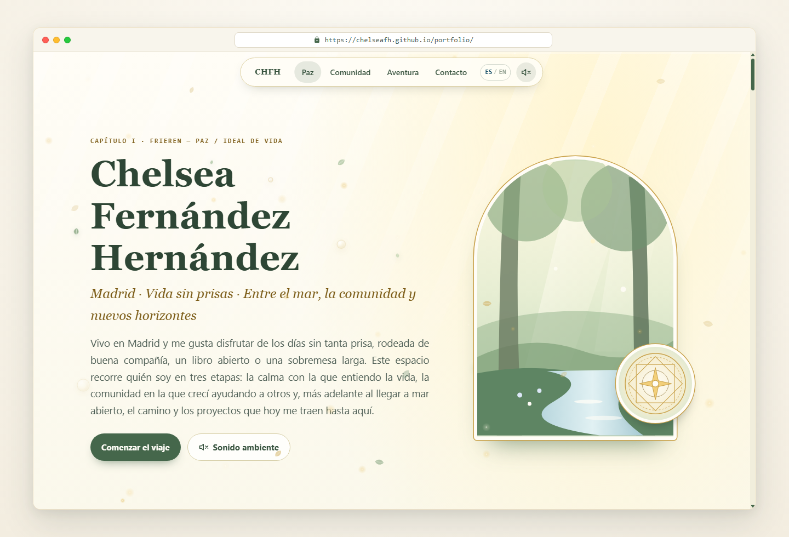
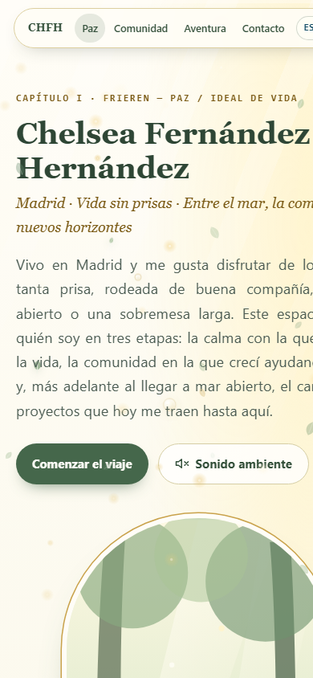

# Portafolio de Ingeniería Telemática & Estudio Comparativo: Agentes Autónomos vs. IA Generativa Monolítica

[](https://chelseafh.github.io/portfolio/)
[](https://github.com/chelseafh/portfolio)
[](https://chelseafh.github.io/portfolio/)
[](LICENSE)
[-informational?style=flat-square)](https://chelseafh.github.io/portfolio/)

<p align="center">
  <a href="https://chelseafh.github.io/portfolio/" target="_blank" rel="noopener noreferrer">
    
  </a>
</p>
<p align="center">
  <em>🌐 Vista previa del portal interactivo en vivo (<a href="https://chelseafh.github.io/portfolio/">chelseafh.github.io/portfolio</a>) — Navegación metamórfica, síntesis de paisajes sonoros con Web Audio API, diseño editorial y soporte bilingüe integral (ES / EN).</em>
</p>

Portal web interactivo, bitácora técnica y estudio experimental de ingeniería de software desarrollado por **Chelsea Fernández Hernández**, estudiante de último curso de **Ingeniería Telemática** en la **Universidad de Alcalá (UAH)** (graduación prevista: **2027**), orientada a **prácticas curriculares (450 h) y extracurriculares (hasta 900 h)**.

🔗 **Enlaces Rápidos:**
- **Demo en vivo en GitHub Pages:** [https://chelseafh.github.io/portfolio/](https://chelseafh.github.io/portfolio/)
- **Currículum Vitae (PDF Oficial):** [assets/CV_Chelsea_Fdez_Hdez.pdf](assets/CV_Chelsea_Fdez_Hdez.pdf)
- **Suite de Pruebas Automatizada:** `portfolio/js/verify-portfolio.js` (29/29 checks en Chromium Headless)

---

## 1. Motivación y Planteamiento del Experimento

El desarrollo de este proyecto nació con un doble propósito fundamental:

1. **Objetivo Profesional:** Construir un portal web interactivo de alto rendimiento que documente con rigor técnico la trayectoria académica, becas de I+D (ALTEN Spain / Instituto Cervantes y Cátedra de Correos) y proyectos de ingeniería telemática de Chelsea Fernández Hernández.
2. **Objetivo Científico-Experimental:** Contrastar experimentalmente dos paradigmas radicalmente distintos de ingeniería de software asistida por Inteligencia Artificial:

### Enfoque A: IA Generativa Monolítica (Chat / Copilot / Prompt-and-Paste)
En el modelo predominante de asistencia por IA, un único modelo de lenguaje de gran tamaño (LLM) atiende peticiones secuenciales en una única sesión de chat. A medida que la base de código crece en complejidad (HTML semántico, hojas de estilo CSS modulares, estructuras de datos jerárquicas, lógica reactiva y suites de test), el enfoque monolítico sufre degradación crítica:
- **Saturación y podredumbre de contexto (*Context Rot*):** La ventana de atención se congestiona con fragmentos obsoletos, provocando alucinaciones sintácticas y olvido de especificaciones previas.
- **Regresiones destructivas:** Para modificar una función pequeña, el modelo suele reescribir archivos completos eliminando utilidades auxiliares o alterando selectores DOM críticos.
- **Falta de gobernanza de seguridad:** No existen barreras de ejecución deterministas; el modelo puede acceder inadvertidamente a variables de entorno sensibles (`.env`), claves privadas o sobrescribir ficheros fuera de su alcance.
- **Carencia de validación formal:** El modelo "cree" que su código funciona basándose en verosimilitud lingüística, sin comprobar errores en consola, desbordamientos de layout ni regresiones visuales.

### Enfoque B: Estudio Multiagente Autónomo (Portfolio Studio / Antigravity Swarm)
Frente al modelo monolítico, se implementó un enjambre de agentes especializados (*Swarm Architecture*) con roles estrictamente desacoplados, coordinados a través de un tablón de mensajes asíncrono y regulados por políticas de seguridad a nivel de sistema operativo:
- **Separación Estricta de Responsabilidades (SoC):** Cada agente posee un área de incumbencia exclusiva (Orquestación, Contenido, Diseño UI/UX o Lógica/Verificación).
- **Consumo Eficiente de Contexto:** Cada agente mantiene su propia ventana de trabajo sin saturarse con los detalles internos de los demás agentes.
- **Gobernanza y Guardas Técnicas (`PreToolUse write_guard`):** Un hook determinista a nivel de runtime intercepta cualquier intento de escritura fuera del directorio permitido (`portfolio/`), garantizando la integridad de los repositorios reales inspeccionados.
- **Bucle Continuo de Verificación Formal (TDD / E2E):** Cada entrega se valida automáticamente en un navegador Chromium headless en dos viewports antes de integrarse en la rama principal.

---

## 2. Tabla Comparativa Crítica: IA Generativa Monolítica vs. Sistema Multiagente

| Dimensión Crítica | IA Generativa Monolítica (Chat / Asistente Único) | Sistema Multiagente Autónomo (Swarm Studio) | Impacto en el Proyecto |
| :--- | :--- | :--- | :--- |
| **Separación de Responsabilidades (SoC)** | **Nula.** Un solo modelo redacta código, escribe copy, diseña estilos y genera pruebas sin división de roles. | **Estricta.** 4 agentes especializados (Orquestador, Diseñador, Redactor Técnico y Desarrollador Lógico). | Evita la contaminación cruzada y garantiza calidad especializada en cada capa. |
| **Gestión y Saturación de Contexto** | **Degradación lineal/exponencial.** La ventana se satura rápidamente con miles de líneas de código y prompts históricos. | **Óptima y asíncrona.** Cada agente gestiona su contexto local y se comunica mediante mensajes concisos con identificador de secuencia (`seq`). | Cero *context rot*; los agentes se suspenden (`swarm_wait`) sin consumir tokens en reposo. |
| **Riesgo de Regresiones y Olvido** | **Muy Alto.** Al editar archivos extensos (>1.000 líneas), trunca funciones, olvida clases CSS previas o rompe contratos DOM. | **Prácticamente Nulo.** Ediciones quirúrgicas dirigidas; pruebas E2E automatizadas detectan cualquier fallo antes de consolidar. | Estabilidad comprobada en 21 rondas de desarrollo sin pérdida de funcionalidades previas. |
| **Control de Concurrencia y Colisiones** | **Inexistente.** Reescrituras globales que pisan el trabajo anterior si no se supervisa línea por línea. | **Regla de No Colisión Activa.** Matriz estricta de propiedad de archivos; dos agentes jamás editan el mismo archivo. | Trabajo en paralelo fluido sin conflictos de merge ni sobrescrituras accidentales. |
| **Bucle de Verificación y Calidad** | **Subjetivo y verbal.** El modelo afirma que el código "funciona perfectamente" sin ejecutarlo en un navegador real. | **Empírico y automatizado.** Ejecución de 29 checks en Chromium Headless (Desktop 1440x900 y Móvil 390x844) en cada ronda. | Detección inmediata de desbordamientos de píxel (`overflowPx <= 0`), errores de audio o desalineación i18n. |
| **Gobernanza y Seguridad** | **Vulnerable.** Propenso a leer o exponer claves en `.env` o alterar archivos del sistema si el prompt lo sugiere. | **Determinista y Blindada.** Hook `write_guard.py` que bloquea escrituras fuera de `portfolio/` y filtra secretos preventivamente. | Máxima privacidad: 0 fugas de contraseñas, IPs internas o datos privados (como el teléfono personal). |
| **Autonomía y Toma de Decisiones** | **Reactiva a micro-prompts.** Requiere intervención humana constante para cada corrección sintáctica o ajuste de estilo. | **Autónoma y colaborativa.** El orquestador descompone objetivos de alto nivel, asigna tareas y los agentes resuelven dependencias. | Chelsea define requisitos de negocio y el sistema auto-gestiona la implementación y prueba técnica. |

---

## 3. Arquitectura del Sistema Multiagente

El entorno de trabajo fue estructurado bajo la gobernanza del plugin local `portfolio-studio`, compuesto por cuatro agentes autónomos que colaboran en un bucle cerrado de diseño, implementación y verificación.

```
                            ┌─────────────────────────────────────────┐
                            │      portfolio-jefe-orquesta            │
                            │      (Coordinador / Arbitraje)          │
                            └────────────────────┬────────────────────┘
                                                 │ Define contratos y rondas
                      ┌──────────────────────────┼──────────────────────────┐
                      ▼                          ▼                          ▼
        ┌──────────────────────────┐ ┌──────────────────────────┐ ┌──────────────────────────┐
        │   portfolio-contenido    │ │     portfolio-diseno     │ │     portfolio-logica     │
        │   (Copywriting / Data)   │ │    (HTML / CSS / UX)     │ │   (Lógica / Reactividad) │
        └─────────────┬────────────┘ └────────────┬─────────────┘ └────────────┬─────────────┘
                      │                           │                            │
                      ▼                           ▼                            ▼
              portfolio-data.js              index.html                     main.js
                 README.md                    style.css               verify-portfolio.js
                      │                           │                            │
                      └───────────────────────────┴────────────────────────────┘
                                                  │
                                                  ▼
                                      ┌───────────────────────┐
                                      │  Chromium Headless    │ ◄── [29/29 Tests PASS]
                                      │  (Desktop & Móvil)    │
                                      └───────────────────────┘
```

### 3.1. Tablón de Comunicación Asíncrona (Swarm Message Board)
En lugar de compartir un único canal síncrono donde todos los modelos reciben todas las interacciones, los agentes operan sobre un tablón de mensajes event-driven:
- **Indexación por secuencias (`seq`):** Cada mensaje posee un número unívoco (#1, #2... #162), permitiendo auditar con exactitud el histórico de decisiones.
- **Menciones dirigidas (`@agente`):** Despiertan únicamente al destinatario relevante, evitando consumo innecesario de inferencia en agentes inactivos.
- **Suspensión sin coste (`swarm_wait`):** Un agente en espera no gasta tokens ni computación hasta que un mensaje en el tablón lo convoca explícitamente.

### 3.2. Los 4 Roles Especializados
1. **Jefe de Orquesta (`portfolio-jefe-orquesta` / Coordinador):**
   - Planifica las rondas de trabajo a partir de los objetivos del usuario.
   - Define los contratos de interfaces (esquemas de datos, selectores DOM e identificadores unívocos).
   - Arbitra dependencias y realiza la integración y validación final antes de cada commit.
2. **Especialista en Contenido y Copywriting Técnico (`portfolio-contenido`):**
   - **Propietario exclusivo de:** `portfolio/js/portfolio-data.js` y `portfolio/README.md`.
   - Analiza e inspecciona los repositorios reales del workspace (`Controlador/`, `Correos_casillero/`, `proyectos/Marchel-Asterisk/`, `proyectos/LRSS-4/`) para redactar casos de estudio de alta fidelidad de ingeniería.
   - Traduce y sincroniza el 100 % de los contenidos al inglés (`PORTFOLIO_I18N.en`).
   - Aplica salvaguardas de privacidad: garantiza cero exposición de credenciales y número de teléfono privado.
3. **Especialista en Diseño UI/UX (`portfolio-diseno`):**
   - **Propietario exclusivo de:** `portfolio/index.html` y `portfolio/css/style.css`.
   - Modela la experiencia estética en torno a los tres universos visuales (Frieren, Avatar Aang y One Piece).
   - Diseña componentes interactivos: báculo rúnico, dados 3D, carruseles infinitos, línea temporal y modales accesibles.
   - Asegura accesibilidad (WCAG 2.1 AA), navegación por teclado (`:focus-visible`) e higiene de color (cero `#000000` puro, cero neones estridentes).
4. **Especialista en Funcionalidades y Lógica (`portfolio-logica`):**
   - **Propietario exclusivo de:** `portfolio/js/main.js` y `portfolio/js/verify-portfolio.js`.
   - Implementa la reactividad modular: motor i18n bidireccional en memoria, filtros combinados en tiempo real y explorador interactivo de arquitectura multinivel.
   - Diseña la síntesis sonora mediante **Web Audio API** (paisajes sonoros y juguete interactivo de la centralita PBX Asterisk).
   - Desarrolla y ejecuta la batería automatizada de pruebas end-to-end en Chromium Headless.

### 3.3. Matriz Estricta de Propiedad de Archivos (Zero Collisions)
Para erradicar conflictos de edición concurrente, cada archivo del proyecto cuenta con un único agente responsable:

| Archivo / Directorio | Agente Propietario | Permiso Otros Agentes |
| :--- | :--- | :--- |
| `portfolio/index.html` | `portfolio-diseno` | Solo lectura |
| `portfolio/css/style.css` | `portfolio-diseno` | Solo lectura |
| `portfolio/js/portfolio-data.js` | `portfolio-contenido` | Solo lectura |
| `portfolio/README.md` | `portfolio-contenido` | Solo lectura |
| `portfolio/js/main.js` | `portfolio-logica` | Solo lectura |
| `portfolio/js/verify-portfolio.js` | `portfolio-logica` | Solo lectura |
| Carpetas externas (`Controlador/`, `Correos_casillero/`, etc.) | **Sistema Protegido** | **Solo lectura estricta** (Bloqueo de escritura por hook) |

### 3.4. Guardas Técnicas de Seguridad (`write_guard`)
La seguridad del workspace no depende de instrucciones en lenguaje natural. Se encuentra respaldada por un hook de pre-ejecución (`PreToolUse write_guard` en `scripts/write_guard.py`):
- Intercepta toda invocación a herramientas del entorno (`write_file`, `edit_file`, comandos bash/powershell).
- Si la ruta de destino no comienza por `portfolio/` o intenta mutar carpetas hermanas, deniega físicamente la operación y aborta el comando.
- Bloquea cualquier intento de inspección de archivos `.env`, claves SSH o bases de datos locales.

---

## 4. El Proyecto Desarrollado: Portafolio de Chelsea Fernández Hernández

### 4.1. Perfil Profesional y Académico
- **Estudiante:** Chelsea Fernández Hernández
- **Titulación:** Grado en Ingeniería Telemática en la **Universidad de Alcalá (UAH)**, Escuela Politécnica Superior.
- **Graduación prevista:** Junio de **2027**.
- **Objetivo Inmediato:** Prácticas curriculares (**450 h**) ampliables a extracurriculares (**hasta 900 h**) en empresas de telecomunicaciones, desarrollo de software distribuido, infraestructura cloud o I+D.
- **Perfil Técnico:** Especialización en arquitectura de software distribuido, microservicios, visión artificial aplicada, telefonía VoIP/SIP y plataformas web reactivas.

### 4.2. Los Tres Capítulos Narrativos
El portal se aleja del formato de currículum convencional estructurándose en tres universos que conectan la trayectoria técnica con los valores personales:

```
    ┌─────────────────────────┐      ┌─────────────────────────┐      ┌─────────────────────────┐
    │       CAPÍTULO I        │      │       CAPÍTULO II       │      │      CAPÍTULO III       │
    │   Sousou no Frieren     │      │       Avatar Aang       │      │        One Piece        │
    │  [Paz e Ideal de Vida]  │      │  [Comunidad e Infancia] │      │  [Aventura Profesional] │
    └───────────┬─────────────┘      └───────────┬─────────────┘      └───────────┬─────────────┘
                │                                │                                │
    • Nací en una isla (mar)         • Torneo Robocampeones           • 4 Proyectos Técnicos Reales
    • Calma del norte verde          • Reto Endesa (AutoCAD/Arduino)  • Explorador de Arquitectura
    • Lecturas y juegos de mesa      • Technovation Girls (Senior)    • Línea Temporal Interactiva
    • Dados 3D y báculo rúnico       • Staff IEEE CNSM 2026           • Bilingüe Completo (ES/EN)
```

1. **Capítulo I — Sousou no Frieren (Paz e Ideal de Vida):**
   - Conexión con el mar al haber nacido en una isla, valorando la calma y la perspectiva pausada.
   - Retiros hacia el norte verde de España, paseos junto a ríos y lecturas profundas (*San Manuel Bueno, mártir* de Unamuno, sagas de fantasía de Brandon Sanderson como *Trenza del mar esmeralda* y *Nacidos de la bruma*, novelas como *1984* y *El cuento de la criada*).
   - Tradición familiar de juegos de mesa (Monopoly, Catán, Virus, LEGO) representada mediante dados 3D interactivos con física CSS (`🎲 Juego al azar` / `📚 Libro al azar`) y un báculo rúnico interactivo con simulación de hechizos de sosiego.

2. **Capítulo II — Avatar Aang (Comunidad e Infancia):**
   - Primer contacto temprano con la tecnología en secundaria: competiciones escolares de robótica en **Robocampeones**.
   - **Reto de Robótica de Endesa:** Diseño de un robot en 3D con **AutoCAD**, fabricación aditiva con **impresora 3D** y programación de su placa controladora **Arduino**.
   - Participación senior en **Technovation Girls**, liderando el desarrollo de una aplicación móvil contra el acoso escolar en **App Inventor**.
   - Cierre del ciclo formativo: mentora en Technovation Girls 2026 (equipo «Inteligents», app *Saludea*) y miembro del equipo de organización y staff en el prestigioso congreso internacional **IEEE CNSM 2026** celebrado en el Paraninfo de la Universidad de Alcalá.

3. **Capítulo III — One Piece (Aventura e Ingeniería):**
   - El salto al mundo profesional: proyectos técnicos de alto nivel, becas de investigación y retos de ingeniería telemática.
   - Explorador interactivo de arquitectura multinivel con 24 nodos inspeccionables.
   - Juguete interactivo de telefonía IP Asterisk conectado a Web Audio API con teclado DTMF y simulador de IVR.
   - Soporte bilingüe integral e instantáneo (`ES / EN`).

### 4.3. Proyectos de Ingeniería Documentados

#### 1. Controlador XR & Portal Educativo VR/MR
- **Contexto:** Beca de Investigación en **ALTEN Spain** en colaboración con el **Instituto Cervantes** (`Controlador/`).
- **Rol y Responsabilidades de Chelsea:**
  - Diseño conjunto de la arquitectura global y desarrollo íntegro del backend `api-servidor` en **FastAPI**.
  - Canal de streaming de audio en tiempo real mediante **WebSockets PCM16**.
  - Pipeline de evaluación de pronunciación híbrido combinando **Faster-Whisper STT**, normalización por expresiones regulares y LLM local con **Ollama**.
  - Infraestructura con **Docker Compose** (10 microservicios: `api-web` Flask, MariaDB, Coqui TTS, Redis y reverse proxy Nginx con SSL).
  - Integración continua y despliegue OTA (Over-The-Air) mediante **GitHub Actions**.

#### 2. Sistema de Visión Artificial para Auditoría de Casilleros
- **Contexto:** Beca de Investigación en la **Cátedra de Correos** (`Correos_casillero/Servidor/`).
- **Rol y Responsabilidades de Chelsea:**
  - Responsable integral de la infraestructura del servidor y del pipeline de visión por computador.
  - Orquestación con **Docker Compose** y reverse proxy **Nginx con cifrado TLS**.
  - API de ingestión y autenticación basada en **FastAPI (`api-core`)** con tokens **JWT**.
  - Cola asíncrona de procesamiento desacoplado en **Redis (AOF)**.
  - Worker de inferencia local en GPU/CPU **YOLOv8-seg / ONNX (`ia-worker`)** para segmentación semántica de paquetes y paquetería en casilleros.
  - Persistencia relacional en **PostgreSQL**, etiquetado de datasets en **Label Studio** y scripts de reentrenamiento continuo.

#### 3. Marchel: Central Telefónica PBX VoIP con Asterisk v22
- **Contexto:** Proyecto de Telemática en la **Universidad de Alcalá (UAH)**, desarrollado en pareja junto a [Marcos Santos Aragón](https://www.linkedin.com/in/marcos-santos-aragon/) (`proyectos/Marchel-Asterisk/`).
- **Rol y Responsabilidades de Chelsea:**
  - Co-desarrollo integral en pareja junto a [Marcos Santos Aragón](https://www.linkedin.com/in/marcos-santos-aragon/): configuración y despliegue de centralita IP sobre Linux basada en **Asterisk v22.2.0** con soporte para el canal **PJSIP**.
  - Integración de extensiones SIP mediante softphones **Zoiper**.
  - Lógica de enrutamiento telefónico mediante dialplan avanzado, operadora automática **IVR**, colas ACD y salas de conferencia con `ConfBridge`.
  - Grabación de llamadas con `MixMonitor` y síntesis vocal en español mediante **Festival TTS**.
  - Registro de detalle de llamadas (CDR) persistido en **MariaDB** y monitorizado mediante un portal de gestión web en **Flask**.

#### 4. Nika App: Mensajería en Tiempo Real & Tarificación Serverless
- **Contexto:** Proyecto de Arquitectura Cloud en la **Universidad de Alcalá (UAH)**, desarrollado en pareja junto a [Marcos Santos Aragón](https://www.linkedin.com/in/marcos-santos-aragon/) (`proyectos/LRSS-4/`).
- **Rol y Responsabilidades de Chelsea:**
  - Co-desarrollo integral en pareja junto a [Marcos Santos Aragón](https://www.linkedin.com/in/marcos-santos-aragon/): desarrollo de una aplicación web de chat bidireccional basada en **Flask-SocketIO**.
  - Arquitectura serverless en **AWS Lambda** programada en Python para el procesamiento asíncrono y tarificación de eventos de mensajería.
  - Integración con base de datos administrada en la nube **AWS RDS MySQL** para auditoría y balance de uso.

---

## 5. Batería de Pruebas y Aseguramiento de la Calidad

Para garantizar que cada entrega cumple con los estándares más exigentes de robustez, accesibilidad y rendimiento, el especialista en lógica implementó una suite de pruebas automatizada (`portfolio/js/verify-portfolio.js`):

```bash
# Ejecución de la suite completa de 29 verificaciones en Chromium Headless
npm test
```

### Resumen de los 29 Checks Automatizados:
1. **Contratos DOM 1:1:** Verificación estricta de la presencia de 30+ identificadores y selectores requeridos en el DOM.
2. **Higiene Visual y Ausencia de Colores Prohibidos:** Comprobación estricta de cero uso de `#000000` puro (utilizando en su lugar la escala `var(--ink)`) y ausencia de colores neón no calibrados.
3. **Cero Desbordamiento Horizontal (*Zero Overflow*):** Validación geométrica en resoluciones de escritorio (`1440x900`) y móvil (`390x844`), garantizando `overflowPx <= 0`.

<p align="center">
  
  <br>
  <em>Vista móvil responsive (390×844) verificada sin desbordamientos ni cortes.</em>
</p>
4. **Paridad de Internacionalización (ES / EN):** Comprobación bidireccional de ida y vuelta para más de 318 claves en `window.PORTFOLIO_I18N`.
5. **Comportamiento del Báculo Rúnico:** Validación de interacción, disparo de efectos en `<canvas id="fx">` y textos atmosféricos.
6. **Rincón de Té del Tío Iroh:** Validación de rotación de citas en el DOM y accesibilidad de controles.
7. **Buscador y Filtros de Proyectos:** Comprobación de filtrado combinado por categoría (Backend, Cloud, IoT, VR) y tecnología con renderizado dinámico.
8. **Modales Accesibles (Caso de Estudio y CV):** Validación de apertura, foco (`trap focus`), cierre por teclado (`Escape`) y click fuera del modal.
9. **Explorador Interactivo de Arquitectura:** Verificación de renderizado de 24 nodos SVG, selección de capas y actualización del panel de detalles.
10. **Juguete Telefónico PBX Asterisk:** Validación de síntesis Web Audio API, tonos DTMF y respuesta del simulador de IVR.
11. **Dados 3D con Simulación de Calma:** Validación de etiquetas compactas (`🎲 Juego al azar` / `🎲 Random game`) y animación CSS 3D sin saltos de línea (`nowrap`).
12. **Privacidad y Cero Fugas de Datos:** Escaneo automatizado que certifica la ausencia de números de teléfono personales en el texto público, claves API o referencias no autorizadas.

---

## 6. Ejecución Local y Despliegue

### 6.1. Ejecución en Local
El portal está construido íntegramente con tecnologías web nativas (**HTML5 semántico**, **CSS3 modular** y **JavaScript vanilla ES6+**), por lo que no requiere ningún proceso de compilación, transpilación ni empaquetado (*zero build step*).

Para levantarlo en local:

```bash
# 1. Clonar el repositorio
git clone https://github.com/chelseafh/portfolio.git
cd portfolio

# 2. Iniciar un servidor HTTP local (Python 3)
python -m http.server 8080
```

Abre tu navegador en `http://localhost:8080` para interactuar con el portal.

### 6.2. Publicación en GitHub Pages
El proyecto se encuentra configurado para despliegue continuo en **GitHub Pages**:
1. El código de la rama principal (`main`) se encuentra en la raíz del repositorio.
2. En la configuración del repositorio en GitHub: **Settings → Pages**.
3. Seleccionar **Source: Deploy from a branch**, rama **`main`** y carpeta **`/ (root)`**.
4. El portal se publicará automáticamente en: `https://chelseafh.github.io/portfolio/`.

---

## 7. Licencia y Créditos

- **Código y Arquitectura:** MIT License. © 2026 Chelsea Fernández Hernández.
- **Narrativa y Diseño Visual:** Inspirado con profundo respeto en las obras *Sousou no Frieren* (Kanehito Yamada / Tsukasa Abe), *Avatar: The Last Airbender* (Michael Dante DiMartino / Bryan Konietzko) y *One Piece* (Eiichiro Oda).
- **Entorno de Agentes Autónomos:** Diseñado y ejecutado sobre la arquitectura de enjambre de **Google Antigravity**.
